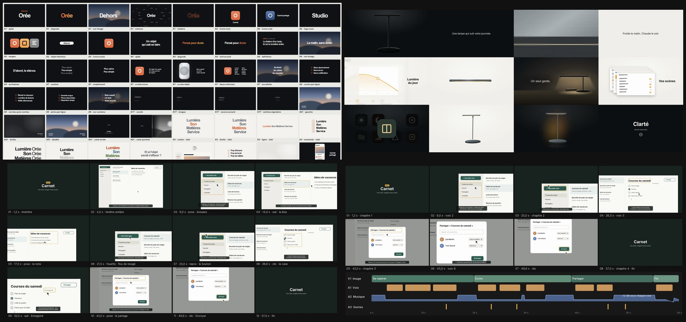
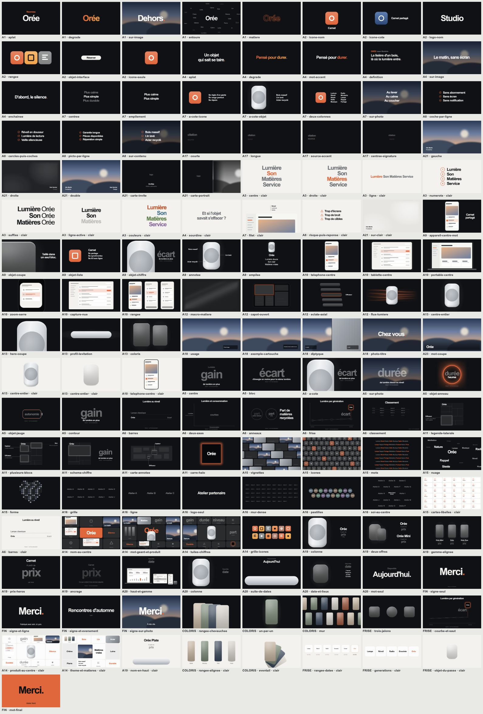
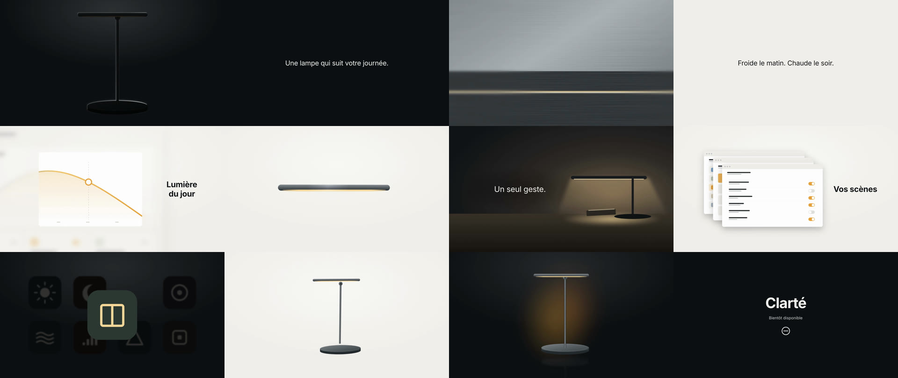
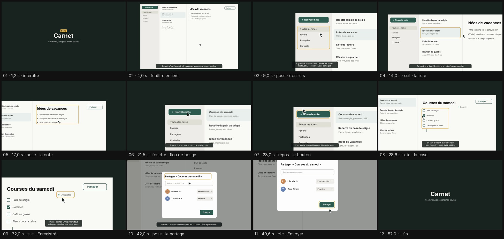
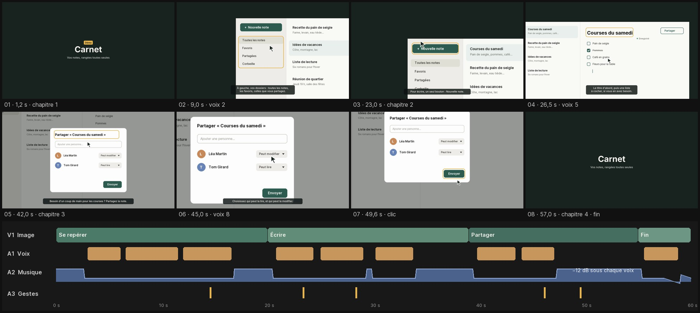

<a href="https://github.com/sebmake/LikeApplePLS/releases/latest">

</a>

# LikeApplePLS

Four Claude skills for people who present, launch, animate and edit, built on the way Apple makes its keynotes. Install the ones you need.

Everyone can tell an Apple keynote when they see one. Saying what makes it work is harder, and "make it look like Apple" gets you big type on black and not much else.

These skills come from eight public Apple keynotes, March 2019 to September 2026, studied slide by slide, shot by shot and frame by frame. Most rules carry a count, so you know how often Apple actually does it, and anything that couldn't be measured is labeled a convention.

What you make keeps your colors, your fonts, your product and your numbers. Nothing from Apple ends up in it.

| Skill | What it does |
|---|---|
| **[Keynote](#keynote)** | A 16:9 deck and the full speaker script |
| **[Product film](#product-film)** | A silent 1-2 minute product film, plus social cut-downs |
| **[Motion design](#motion-design)** | How to animate each element, then the After Effects or EffectCraft script |
| **[Video edit](#video-edit)** | Cuts your footage, assembles narrated chapters, reviews an edit |

## Install

Pick the skills you want. The installer lists the four and lets you check the ones to add:

```bash
npx skills@latest add sebmake/LikeApplePLS
```

Or name them directly:

```bash
npx skills@latest add sebmake/LikeApplePLS --skill sebmake-keynote-likeapple-pls
npx skills@latest add sebmake/LikeApplePLS --skill sebmake-motiondesign-likeapplepls sebmake-videoedit-like-applepls
npx skills@latest add sebmake/LikeApplePLS --all
```

As Claude Code plugins, one marketplace and one plugin per skill:

```bash
claude plugin marketplace add sebmake/LikeApplePLS
claude plugin install sebmake-keynote-likeapple-pls@likeapplepls
claude plugin install sebmake-videopresentation-likeapplepls@likeapplepls
claude plugin install sebmake-motiondesign-likeapplepls@likeapplepls
claude plugin install sebmake-videoedit-like-applepls@likeapplepls
```

On Claude.ai, upload the `.skill` file of each skill from the [latest release](https://github.com/sebmake/LikeApplePLS/releases/latest).

## Why use it?

The look is the easy part.

The rules underneath are less obvious, and some go against common habits. No number ever counts up to its value (0 out of 27). In the films that save the product for the end, it shows up in full between 69% and 82% of the running time, never in the first shot. Music doesn't drive the cuts. Over 95% of shot changes are straight cuts, and a text card stays up 1.2 s plus 0.3 s per word.

An agent left to itself will guess at all of that, and it will make up what's missing too. In a side-by-side test on decks, the agent working without the skill invented amounts to fill the empty slides. These skills don't: a missing figure, price or date stays as a placeholder in a deck or a film, and the editing skill leaves out any name or quote you didn't give it.

## Keynote



**[sebmake-keynote-likeapple-pls](./sebmake-keynote-likeapple-pls/SKILL.md)** builds a 16:9 deck the way Apple builds its keynotes, plus the script to read over it, for Keynote, PowerPoint, Figma Slides, Canva or video. It asks one question about your audience, which decides how sources and figures are shown, then plans the run of show and designs slide by slide in your own branding.

Needs Node 18 or later and Python 3.9 or later.

## Product film



**[sebmake-videopresentation-likeapplepls](./sebmake-videopresentation-likeapplepls/SKILL.md)** makes a voiceless product film of one to two minutes, cut like Apple's reveal films: a hook, a build-up, a late reveal, the name at the end. Then it recomposes 15 to 60 second versions for social in 16:9, 9:16 and 1:1, never just cropped. It renders MP4s with HyperFrames, over your own music or none.

Needs Node 22 or later with `npx hyperframes`, ffmpeg and Python 3.9 or later.

## Motion design



**[sebmake-motiondesign-likeapplepls](./sebmake-motiondesign-likeapplepls/SKILL.md)** tells you how to animate a title, a list, a hero number, a logo, a product shot, a screenshot or a transition, from about 640 animations measured in the keynotes, then writes the After Effects or EffectCraft script. You see the plan element by element before it writes a line.

It also builds narrated app walkthroughs as an EffectCraft project you can open and understand. The window carries the camera: its anchor point is what you look at and its scale is the zoom. Highlights and the cursor are children of the window, so they follow on their own. A probe then reads the composition back and flags anything that leaves the frame or moves too fast without motion blur, and your hand edits are carried into the source before it regenerates.

Needs Node 18 or later, Python 3.9 or later and ffmpeg, plus After Effects or EffectCraft (`open -a EffectCraft --args --control 9877`, window in front).

## Video edit



**[sebmake-videoedit-like-applepls](./sebmake-videoedit-like-applepls/SKILL.md)** cuts your footage the way Apple cuts the films in its keynotes, in FilmCraft (which it drives) or as an FCP7 XML or EDL for DaVinci Resolve and Premiere Pro. It also assembles pieces that are already made: rendered chapters, one voice file per line, subtitles, music that dips under the voice and sound effects, each on its own named track. And it reviews an edit you've already made, shot by shot, usually down to the timecode.

Needs Python 3.9 or later with ffmpeg; footage analysis and the review also need numpy and Pillow (`python3 -m venv ~/.venv-videoedit && ~/.venv-videoedit/bin/pip install numpy pillow`).

## Voice-over

The motion design and video edit skills can make a voice-over when you don't have one. They recommend edge-tts, free and natural-sounding, and install it in `~/.venv-sebmake-voix` only if you say yes. You approve the lines and pick the voice from a short audition first. edge-tts goes through an unofficial Microsoft online service, so the skill says so when a film is meant for the public.

## Limits

- After Effects, Premiere Pro and DaVinci Resolve weren't available while the skills were built. Scripts and files were tested in EffectCraft and FilmCraft.
- Vertical and square formats reuse the 16:9 rules: none of the source films is vertical or square.
- Field names inside the JSON files the skills write (`motion.json`, `scene.json`, `montage.json`…) are French identifiers. Each format's reference page has a glossary.
- The walkthrough and assembled-edit rules are conventions tested on two films, not measurements from the keynotes.

---

Not affiliated with, endorsed or sponsored by Apple Inc. Apple, Keynote and Final Cut Pro are trademarks of Apple Inc., registered in the U.S. and other countries. After Effects and Premiere Pro are trademarks of Adobe. DaVinci Resolve is a trademark of Blackmagic Design. MIT License.
